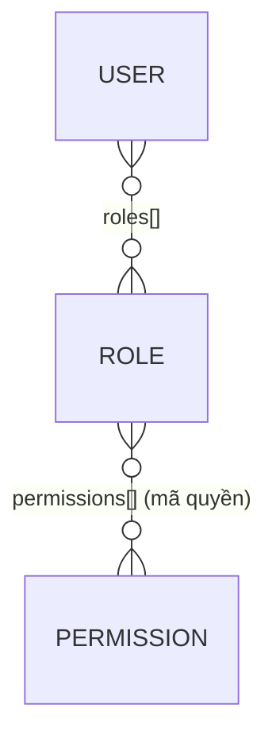

# RBAC App — Quản lý Người dùng & Phân quyền

Bài tập **Ex3. Fullstack RBAC** (IT4409): hệ thống quản lý người dùng, vai trò và quyền theo mô hình Role-Based Access Control.

| Thư mục | Công nghệ | Mô tả |
| :--- | :--- | :--- |
| [`backend/`](backend/README.md) | Node.js, Express 5, Mongoose, JWT | REST API `/api/v1`, kiểm tra quyền ở mỗi request |
| [`frontend/`](frontend/) | React 19, Vite, Axios | Giao diện đăng nhập, quản lý người dùng / vai trò, hồ sơ cá nhân |
| `backend/postman_collection.json` | Postman v2.1 | Bộ test xác thực, permissions, roles, users |

## Yêu cầu

- Node.js ≥ 22 (backend dùng `Set.prototype.symmetricDifference`)
- MongoDB (Atlas hoặc local)

## Chạy nhanh

```bash
# 1. Backend
cd backend
cp .env.example .env        # điền MONGODB_URI, JWT_SECRET
npm install
npm run seed                # tạo 10 quyền, 5 vai trò, 5 tài khoản mẫu
npm run dev                 # http://localhost:3001

# 2. Frontend (terminal khác)
cd frontend
npm install
npm run dev                 # http://localhost:5173
```

Frontend gọi `http://localhost:3001/api/v1` mặc định. Đổi sang server khác (vd. mock server của giảng viên) bằng file `frontend/.env.local`:

```bash
VITE_API_BASE=<MOCK_URL>/good/api/v1
```

> Origin của frontend phải có trong `CORS_ORIGINS` của backend, nếu không mọi request báo lỗi mạng.

## Tài khoản mẫu

Mật khẩu chung: `Admin@2026`

| Email | Vai trò | Thấy gì trên giao diện |
| :--- | :--- | :--- |
| `20225000@sis.hust.edu.vn` | super-admin | Toàn bộ chức năng |
| `20225001@sis.hust.edu.vn` | user-manager | Quản lý người dùng, gán vai trò (không xóa) |
| `20225002@sis.hust.edu.vn` | auditor | Chỉ xem người dùng, vai trò |
| `20225003@sis.hust.edu.vn` | shift-leader | Xem / sửa người dùng (vai trò tùy chỉnh) |
| `20225005@sis.hust.edu.vn` | member | Chỉ "Hồ sơ của tôi" |

## Mô hình phân quyền



- Quyền dạng `resource:action`: `users:read|create|update|delete`, `roles:read|create|update|delete|assign`, `permissions:read`.
- Quyền hiệu lực của người dùng = hợp các quyền của mọi vai trò, tính lại từ DB ở **mỗi request** (JWT chỉ chứa `sub`).
- Frontend chỉ dùng quyền để ẩn/hiện nút; backend là nơi quyết định cuối cùng.
